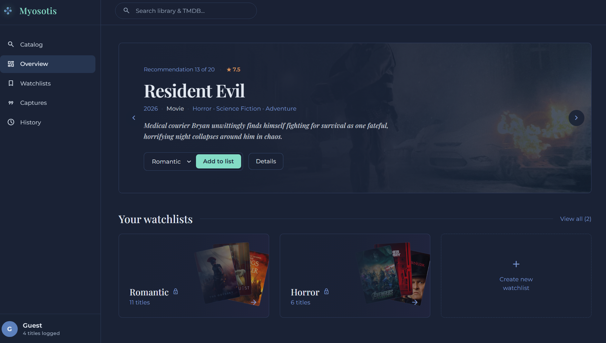
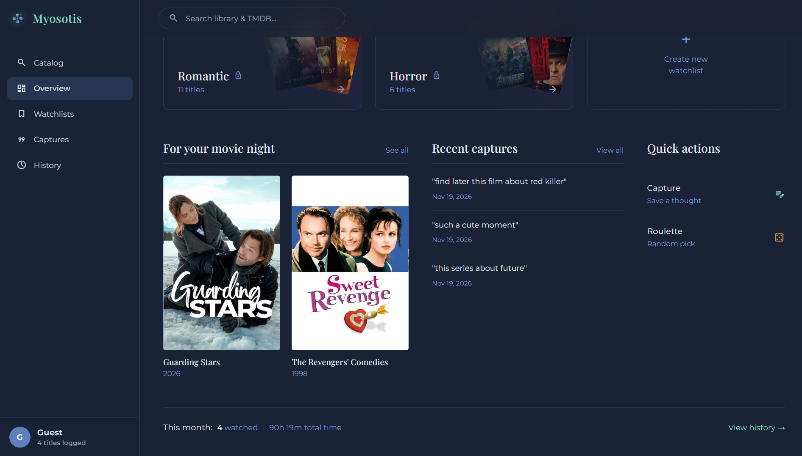
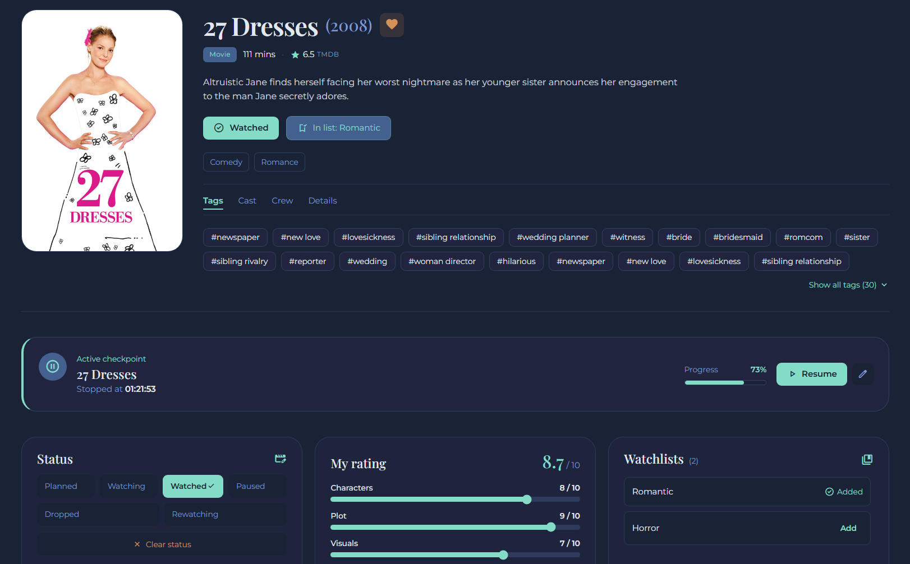
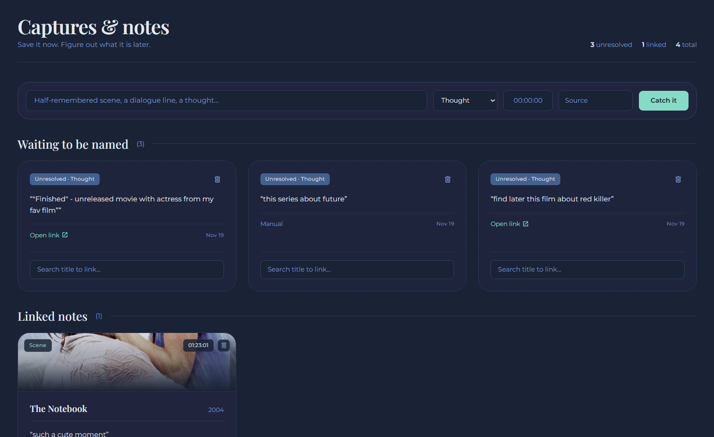
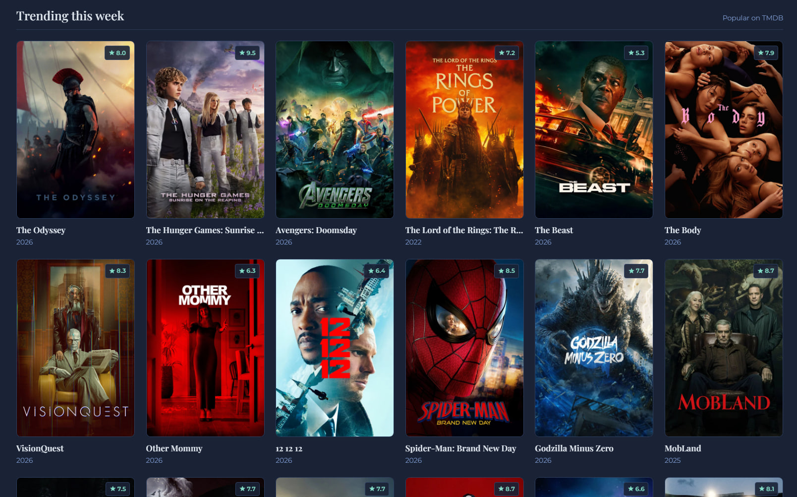

 <div align="center">


# Myosotis

> **Myosotis** — персональний застосунок для пошуку, організації та відстеження фільмів і серіалів.


</div>

---

## Ідея

Ідея проєкту поєднує можливості каталогу медіа, персональних списків перегляду, історії перегляду, нотаток та системи збереження випадково знайденого контенту.

Основна особливість проєкту — **Нотатки**: користувач може швидко зберегти будь-яку згадку про фільм або серіал у довільній формі, навіть якщо він ще не знає його точної назви. Пізніше ця нотатка може бути пов’язана з конкретним медіа та додана до відповідного списку.

На відміну від звичайного каталогу, Myosotis робить акцент на **персональному контексті користувача**.
Тобто користувач може спочатку зберегти нечітку згадку про контент, а структурувати її пізніше.

## Мета
Створити єдину екосистему для комфортного управління кіно-вподобаннями, яка дозволяє користувачеві:
- Знаходити актуальні фільми та серіали, переглядати акторський склад, трейлери й постери через інтеграцію з TMDb API.
- Створювати власні приватні чи публічні добірки та зберігати особисті коментарі до них.
- Контролювати статус перегляду та фіксувати перегляд через систему чекпоінтів.
- Використовувати унікальну систему оцінювання за шістьма критеріями та переглядати щомісячну статистику переглядів.
- Використовувати функцію «Рулетки» та рекомендації на основі вільних хвилин або улюблених жанрів.

## Для кого цей застосунок?

Застосунок створений для активних кіноманів і любителів серіалів, чия інформація про цікавий контент зазвичай розкидана між месенджерами, нотатками в телефоні та вкладками браузера. 

## Можливості

| Функція | Опис |
|---|---|
|  Captures | Нотатки типів `Thought`, `Quote`, `Scene`, `Note` зі статусами `Unresolved → Resolved → Archived` |
|  Watchlists | Приватні та публічні добірки з особистими нотатками до кожного тайтлу |
|  Tracking | Статуси перегляду: `Planned`, `Watching`, `Watched`, `Paused`, `Dropped`, `Rewatching` |
|  WatchCheckpoint | Збереження контексту перегляду: сезон і серія або таймкод, а також причина паузи |
|  Roulette | Випадковий вибір серед ще не переглянутих тайтлів з урахуванням доступного часу та жанру |
|  Recommendations | Рекомендації схожих тайтлів на основі спільних жанрів |
|  Vibe Rating | Оцінювання за шістьма критеріями: Characters, Plot, Visuals, Pacing, Vibe, Soundtrack |
|  Статистика | Щомісячна статистика переглядів: кількість, час, жанри та режисер, чиї роботи переглядалися найчастіше |
|  Пошук | Пошук за назвою, жанром та актором |

## Технології

| Технологія | Призначення |
|---|---|
| C# / .NET 10 | Основна мова програмування та середовище виконання |
| Blazor Server | Користувацький інтерфейс |
| Tailwind CSS (CDN) | Стилізація інтерфейсу |
| MudBlazor | Діалогові вікна та сповіщення |
| Material Symbols | Іконки |
| TBDB API | База медіа |

## Обґрунтування вибору технології

Основною мовою розробки проєкту обрано **C#**.

C# добре підтримує основні принципи ООП, які є фундаментальними для подальшого навчання та поглиблення в ООП. 
С# є С-подібною мовою, тож поріг входження та розуміння є легшим, так як досвід вивчення С++ був увесь 1 курс.
Платформа .NET також дозволяє розвивати проєкт від початкового прототипу до застосунку з графічним інтерфейсом, зовнішніми API та постійним збереженням даних.

## Поточний стан

- Реалізовано предметну модель і основні сервіси.
- Створено сторінки Blazor: Overview, Watchlists, Captures, History, Search, MediaDetails.
- Інтегровано TMDb API для пошуку фільмів і серіалів та отримання детальної інформації про них.
- Дані користувацьких списків і історії переглядів наразі зберігаються в JSON та зберігаються після перезапуску застосунку.
- Розгортання застосунку в Azure заплановано на наступні етапи.

## Модель предметної області (основні класи)

| Клас | Призначення |
|---|---|
| `Media` | Абстрактна базова сутність медіаконтенту |
| `Movie` / `Series` | Типи медіаконтенту |
| `Person` / `Actor` / `Director` | Люди, пов'язані з тайтлами |
| `User` | Власник списків, нотаток, історії перегляду, статусів і чекпоінтів |
| `Watchlist` / `WatchlistEntry` | Користувацькі добірки та записи в них |
| `CaptureEntry` | Необроблена нотатка, яку згодом можна пов'язати з конкретним тайтлом |
| `WatchCheckpoint` | Збережена позиція перегляду та контекст паузи |
| `VibeRating` | Оцінювання за шістьма критеріями з перевіркою значень у діапазоні 0–10 |

## Скріншоти

### Home Page



### Movie Details


### Captures & Notes


### Trending Page


## Дизайн

<div align="center">
  <a href="https://canva.link/oh12vzw1rp4tucj" target="_blank">

  </a>
  <br><br>
  
  <!-- Колірна палітра -->
  
  
  
  
  
  
[Переглянути на Coolors](https://coolors.co/1a2235-332d57-5c80bc-84dcc6-e2e8f0-d4915a)
</div>

## Локальний запуск

## Запуск проєкту

### Що потрібно
- [.NET SDK](https://dotnet.microsoft.com/download)
- Безкоштовний API-ключ від [The Movie Database (TMDb)](https://www.themoviedb.org/)

### Локальний запуск
1. Клонуйте репозиторій:
   ```bash
   git clone [https://github.com/borjomiversus/Myosotis.git](https://github.com/borjomiversus/Myosotis.git)
   cd Myosotis
   ```
2. Вкажіть свій ключ TMDb у вебпроєкті (`MyosotisWeb`) — наприклад, через user secrets або налаштування конфігурації (не додавайте реальні ключі в git).
3. Запустіть вебзастосунок:
   ```bash
   cd MyosotisWeb
   dotnet run
   ```

### Запуск тестів
```bash
dotnet test
```

## Структура проєкту

```text
Myosotis/
├── .github/        # CI/CD workflows
├── MyosotisWeb/    # Застосунок Blazor (інтерфейс і вебсервіси)
├── code/           # Предметна модель і основна логіка
├── Myosotis.Tests/ # Юніт-тести
├── docs/           # Документація та медіа для README
└── README.md
```

## Дорожня карта

- [x] Предметна модель і сервіси
- [x] Інтерфейс Blazor: Overview, Watchlists, Captures, History, Search
- [x] Roulette, рекомендації, щомісячна статистика
- [x] Сторінка фільму / серіалу
- [x] Інтеграція TMDb (метадані та постери)
- [x] Збереження даних у JSON
- [ ] Розгортання в Azure
- [ ] Користувацький профіль

## Процес розробки

- **Ідея та концепція продукту.** Myosotis задумувався як простір для зберігання інформації про фільми й серіали в одному місці, ведення історії переглядів та формування списку контенту для майбутнього перегляду. Назва Myosotis походить від латинської назви квітки незабудки та відображає основну ідею застосунку: зберігати інформацію, яку не хочеш забувати. Ця концепція також знайшла відображення у візуальному оформленні, зокрема у виборі кольорів, натхненних образом квітки. Ідея виникла з бажання створити власний застосунок на цю тему, що водночас відповідав би вимогам навчального проєкту з ООП, давав змогу працювати з C# та поглибити знання в процесі розробки.

- **Дизайн інтерфейсу.** На початковому етапі досліджувалися візуальні рішення та створювалися прототипи за допомогою Google Stitch і референсів сучасних вебзастосунків. На основі цих матеріалів сформовано візуальний стиль Myosotis, який надалі адаптувався відповідно до функціональності та технічних можливостей застосунку.

- **Програмна логіка на C#/.NET.** Під час розробки вивчалися принципи проєктування ПЗ, об'єктноорієнтоване програмування, побудова моделей, класів, сервісів та їхня взаємодія. C# і .NET використовувалися для реалізації програмної логіки та основних функцій Myosotis.

- **Навчання та дослідження технічних рішень.** Для навчання й пошуку рішень використовувалися відеоуроки, офіційна документація, відкриті репозиторії GitHub, обговорення на Reddit і Stack Overflow та інші онлайн-ресурси. Засоби ШІ застосовувалися для пояснення незнайомих концепцій, дослідження можливих підходів до реалізації, генерації та доповнення коду, рефакторингу й пошуку помилок. Частина програмної логіки та компонентів інтерфейсу створювалася за допомогою ШІ й надалі адаптувалася до потреб і структури проєкту.

- **Користувацький інтерфейс.** Інтерфейс реалізовано на Blazor із використанням MudBlazor і Tailwind CSS. MudBlazor застосовується для готових UI-компонентів та інтерактивних елементів, а Tailwind CSS - для компонування, стилізації й адаптації сторінок. Під час розробки поєднувалися можливості готових бібліотек, власні зміни та рішення, запропоновані за допомогою ШІ.
  
- **Інтеграція з TMDb API.** API The Movie Database використовується для отримання інформації про фільми й серіали. 

- **Використання інструментів ШІ.** Gemini, Claude використовувалися як допоміжні інструменти для навчання, вивчення нових технологій, отримання пояснень щодо C#, .NET, Blazor і роботи з API, дослідження можливих технічних рішень, генерації та доповнення коду, рефакторингу компонентів, пошуку й виправлення помилок, а також опрацювання інтерфейсу. 
Google Stitch використовувався для дослідження та прототипування дизайну інтерфейсу. Створені прототипи слугували орієнтиром для подальшої реалізації й адаптації інтерфейсу в застосунку. [Переглянути проєкт у Google Stitch](https://stitch.google.com/projects/32231074868639292).
GitHub Copilot використовувався, зокрема, для допомоги з оформленням README.

- **Модульне тестування (Unit Tests):** реалізовано окремий тестовий проєкт на базі **xUnit** (`MediaDomainTests`, `PeopleTests`, `ServicesTests`, `UserInteractionsTests`), що перевіряє доменну логіку, розрахунки, валідацію граничних значень та обробку винятків.

- **Стиль кодування:** дотримано стандартів [Microsoft C# Coding Conventions](https://learn.microsoft.com/en-us/dotnet/csharp/fundamentals/coding-style/coding-conventions).

- **Документація та сторонні матеріали.** Під час розробки використовувалися офіційна документація, навчальні матеріали, відкриті проєкти та дизайнерські референси. Відповідні джерела наведено в розділі [Джерела](#джерела).

## Відповідність вимогам лабораторних робіт

### Лабораторна робота №1: Базові ідеї ООП

1. **Кількість класів та типів (вимога: $\ge 9$)** — реалізовано **понад 25 власних класів та структур** (без урахування DTO для API та сховища):
   * *Доменна модель:* `Media` (абстрактний), `Movie`, `Series`, `Season`, `Episode`, `Person` (абстрактний), `Actor`, `Director`, `User`, `Watchlist`, `WatchlistEntry`, `UserMediaState`, `WatchHistoryEntry`, `WatchCheckpoint`, `CaptureEntry`, `VibeRating`, `TmdbReview`, `FranchiseTimeLine`.
   * *Сервіси та фільтри:* `MediaSearch`, `MediaRecommendation`, `TimecodeParser`, `DemoDataService`, `TmdbApiService`, `AnonymousUserDataService`, `AnonymousUserMiddleware`, `UserSessionContext`, `UserMapper`, `AdvancedSearchFilters`, `SelectedKeyword`, `UiHelpers`.
   * *Переліки (`enum`):* `WatchStatus`, `ActivityAction`, `CaptureStatus`, `CaptureKind`, `SearchMediaType`.

2. **Кількість полів та властивостей (вимога: $\ge 15$)** — реалізовано **понад 75 полів та властивостей** із контрольованим доступом (`private set`, `readonly`, обчислювані властивості).

3. **Кількість нетривіальних методів та функцій (вимога: $\ge 25$)** — реалізовано **понад 40 нетривіальних методів**, зокрема:
   * *Бізнес-логіка та обчислення:* `Movie.CalculateTimeDebt()`, `Series.CalculateTimeDebt()`, `Series.TotalDurationMinutes`, `Series.MarkEpisodeWatched()`, `VibeRating.Validate()`, `VibeRating.GetAverageScore()`, `TimecodeParser.TryParse()`, `CaptureEntry.TrySetTimecode()`, `CaptureEntry.Resolve()`, `User.SetStatus()`, `User.ToggleFavorite()`, `User.GetMonthlyGenreStats()`, `Watchlist.AddEntry()`.
   * *Пошук та рекомендації:* `MediaRecommendation.FindSimilar()` (багатокритеріальне ранжування), `MediaSearch.SearchByTitle()`, `MediaSearch.FilterByGenre()`, `MediaSearch.AdvancedSearch()`, `DemoDataService.RebuildLibraryFromUser()`, `DemoDataService.GetOrAddToLibrary()`.
   * *Інфраструктура та API:* `TmdbApiService.SearchMediaPagedAsync()`, `DiscoverMediaPagedAsync()`, `EnrichMediaDetailsAsync()`, `PopulateSeriesSeasonsAndEpisodesAsync()`, `UserMapper.ToDto()`, `UserMapper.ToDomain()`, `UserMapper.GetOrCreateMedia()`, `AnonymousUserDataService.GetUserDataAsync()`, `SaveUserDataAsync()`.

4. **Ієрархії успадкування (вимога: $\ge 2$ ієрархії, хоча б одна з $\ge 3$ класів):**
   * **Ієрархія 1 (3 класи):** `Media` (абстрактний базовий клас) $\rightarrow$ `Movie`, `Series`.
   * **Ієрархія 2 (3 класи):** `Person` (абстрактний базовий клас) $\rightarrow$ `Actor`, `Director`.
   * **Ієрархія 3 (фреймворк UI):** `LayoutComponentBase` $\rightarrow$ `MainLayout`.

5. **Поліморфізм (вимога: $\ge 3$ незалежні випадки — статичний та динамічний + клієнтський код):**
   * *Динамічний поліморфізм (run-time):*
     1. Перевизначення (`override`) абстрактних методів/властивостей `CalculateTimeDebt()`, `TotalDurationMinutes` та `UpdateRuntimeInfo()` у класах `Movie` та `Series`.
     2. Перевизначення віртуальних методів `Equals()` та `GetHashCode()` від `object` у класі `SelectedKeyword`.
     3. Реалізація інтерфейсу `IComparable<Media>` (`CompareTo`) у класі `Media`.
   * *Статичний поліморфізм (compile-time):*
     4. Перевантаження конструкторів у класі `WatchCheckpoint` (окремі конструктори для `Series` із сезоном/серією та для `Movie`).
     5. Узагальнене програмування (Generics): `List<Media>`, `Dictionary<Guid, Media>`, `HashSet<int>`, `EventCallback<Media>`.
   * *Клієнтський код:* `Watchlist`, `User.WatchHistory`, `DemoDataService.RebuildLibraryFromUser()` та `MediaRecommendation.FindSimilar()` працюють з узагальненими колекціями базового типу `List<Media>`, викликаючи поліморфні члени без прив'язки до конкретного типу.

6. **Інкапсуляція:** усі доменні класи захищають свої інваріанти через `private set` для властивостей, `protected` конструктори базових класів (`Media`, `Person`) та валідацію вхідних даних у методах і конструкторах із генерацією винятків (`ArgumentException`, `ArgumentOutOfRangeException`).

### Лабораторна робота №2: Графічний інтерфейс користувача (GUI)

Інтерфейс реалізовано як веб-застосунок на **Blazor Server** із бібліотекою компонентів **MudBlazor**.

1. **Кількість вікон / сторінок (вимога: $\ge 4$)** — реалізовано **9 сторінок та 2 модальні вікна**:
   * *Сторінки:* Головна (`Home.razor`), Пошук та каталог (`Search.razor`), Деталі медіа (`MediaDetails.razor`), Сторінка персони (`PersonDetails.razor`), Списки перегляду (`Watchlists.razor`), Деталі списку (`WatchlistDetails.razor`), Історія активності (`History.razor`), Швидкі нотатки (`Captures.razor`), Статистика (`Stats.razor`).
   * *Модальні діалоги:* Рулетка вибору фільму (`RouletteDialog.razor`), діалог створення/редагування чекпойнта (`MediaDetails.razor`).

2. **Елементи керування та контейнери (вимога: $\ge 20$ контролів, $\ge 1$ контейнер):**
   * *Контейнери:* `MudTabs` (вкладки інформації, сезонів серіалу, фільмографії), горизонтальні каруселі (`MediaCarousel.razor`), адаптивні сітки карток, списки елементів, згортані блоки тексту та списків.
   * *Елементи керування (понад 50 у сумі):* поля текстового пошуку, числові інпути (роки, рейтинг, номери сезону/серії), кнопки дій, випадаючі списки вибору вішліста, фільтри-чіпси жанрів та ключових слів, інтерактивні оцінки за 6 критеріями `VibeRating`, навігаційне меню, сповіщення `MudSnackbar`.

3. **Обробники подій (вимога: $\ge 10$)** — реалізовано **понад 25 обробників подій**:
   * UI-події компонентів: `@onclick` (додавання до списків, зміна статусу перегляду, перемикання вкладок/пагінації, розгортання описів), `@oninput` (живий пошук та автодоповнення), `@onkeydown` (швидке збереження нотатки за `Enter`), `@onchange`.
   * Міжкомпонентні та сервісні події: `EventCallback<Media> OnSelect` у `MediaCarousel.razor`, глобальна подія стану `public event Action? OnStateChanged` у `DemoDataService`.

4. **Розділення бізнес-логіки та UI:** доменні сутності (`Domain`) та алгоритми пошуку/рекомендацій (`Services`) не містять залежностей від Blazor або HTTP; робота із зовнішнім API (`TmdbApiService`) та файловим сховищем (`AnonymousUserDataService`) винесена в окремі інфраструктурні сервіси.

## Лабораторна робота №3: Використання зовнішніх бібліотек та фреймворків

У проєкті використано дві зовнішні бібліотеки (NuGet-пакети), які не входять до стандартної бібліотеки .NET:

1. **MudBlazor** (`MudBlazor` v7+) — зовнішня бібліотека Material Design UI-компонентів для Blazor.
   * *Використані можливості:* система модальних вікон (`IDialogService`, `MudDialog` для рулетки вибору фільму та чекпойнтів), спливаючі сповіщення (`ISnackbar`, `MudSnackbar` для валідації фільтрів у пошуку), вкладки (`MudTabs`), фільтри-чіпси (`MudChipSet`), адаптивна сітка (`MudGrid`, `MudItem`), поля введення та кнопки.
2. **Newtonsoft.Json (`Json.NET`)** — зовнішня бібліотека для серіалізації та десеріалізації даних у формат JSON.
   * *Використані можливості:* `JsonConvert.SerializeObject` / `JsonConvert.DeserializeObject` у сервісі `AnonymousUserDataService` для збереження стану анонімного користувача (`UserStorageDto`), налаштування безпеки та форматування через `JsonSerializerSettings` (`TypeNameHandling.None`, `ObjectCreationHandling.Replace`, `Formatting.Indented`).

## Джерела

### Проєкти для дослідження та приклади реалізації

Репозиторії та вебзастосунки, які використовувалися для ознайомлення з підходами до реалізації функціональності, організації коду та побудови інтерфейсу.

- [Movie-Tracker-App (ertugrulgacal)](https://github.com/ertugrulgacal/Movie-Tracker-App)
- [movieTracker (LeilaniL)](https://github.com/LeilaniL/movieTracker)
- [Movie-Website (krishnashah122)](https://github.com/krishnashah122/Movie-Website)
- [Movie Suggest](https://moviesuggest.netlify.app/)
- [SignalR Blazor Chess](https://github.com/csuka1219/SignalR_BlazorChess)
- [Radarr](https://github.com/Radarr/Radarr)
- [Jellyfin](https://github.com/jellyfin/jellyfin)
- [Ryot](https://github.com/ignisda/ryot)
- [Flox (Movie Tracker)](https://github.com/devfake/flox)
- [Serializd (Discover)](https://serializd.com/discover)
- [Awesome Blazor](https://github.com/AdrienTorris/awesome-blazor)

### Дизайн та UI/UX

Візуальні референси, дизайн-концепції, бібліотеки компонентів та інструменти, які використовувалися для дослідження й прототипування інтерфейсу.

- [Google Stitch, прототип Myosotis](https://stitch.google.com/projects/32231074868639292)
- [Spotify Wrapped Dashboard Concept](https://dribbble.com/shots/14686871-2020-Spotify-Wrapped-Dashboard-Concept)
- [Abstract Star Logo Concept](http://dribbble.com/shots/26983428-Abstract-Star-Logo-Concept-Modern-Gradient-Logo-Concept-for-App)
- [Dribbble, Movie Site](https://dribbble.com/search/movie-site)
- [Dribbble, Raycast](https://dribbble.com/search/raycast)
- [Tracksaga](https://tracksaga.com/en)
- [Letterboxd](https://letterboxd.com/)
- [Serializd](https://serializd.com/discover)
- [Trakt](https://app.trakt.tv/)
- [IMDB](https://www.imdb.com/)
- [Pinterest](https://www.pinterest.com/search/pins/?q=movie%20tracker%20app%20ui&rs=ac&len=17&source_id=ac_KqpeUwYz&eq=movie%20tracker%20app&etslf=8663)
- [Glassmorphism (Dribbble)](https://dribbble.com/tags/glassmorphism)
- [OriginKit](https://www.originkit.dev/)
- [SmoothUI](https://smoothui.dev/docs/components)
- [MudBlazor Documentation](https://mudblazor.com/docs/overview)
- [Design.dev Tools](https://design.dev/tools/)
- [Concepts](https://www.reddit.com/r/learnprogramming/comments/1sll0yb/what_are_good_places_of_inspo_for_frontend_design/)

### Офіційна документація

- [Blazor Hosting Models](https://learn.microsoft.com/en-us/aspnet/core/blazor/hosting-models?view=aspnetcore-10.0#blazor-webassembly)
- [Calling a Web API from a .NET Client](https://learn.microsoft.com/fr-fr/aspnet/web-api/overview/advanced/calling-a-web-api-from-a-net-client)
- [Console WebApiClient Tutorial](https://learn.microsoft.com/en-us/dotnet/csharp/tutorials/console-webapiclient)
- [System.Text.Json: JSON Serialization and Deserialization](https://learn.microsoft.com/ru-ru/dotnet/standard/serialization/system-text-json/how-to)
- [Deploy a Blazor App on Azure Static Web Apps](https://learn.microsoft.com/en-us/azure/static-web-apps/deploy-blazor)
- [Blazor Tutorial (Microsoft)](https://dotnet.microsoft.com/en-us/learn/aspnet/blazor-tutorial/intro)
- [TMDb API: Getting Started](https://developer.themoviedb.org/docs/getting-started)
- [TMDb API: Movie Details](https://developer.themoviedb.org/reference/movie-details)
- [C# Player’s Guide](https://csharpplayersguide.com/)
- [C# language documentation](https://learn.microsoft.com/en-us/dotnet/csharp/)
- [C# Succinctly](https://www.syncfusion.com/succinctly-free-ebooks/csharp)
- [freeCodeCamp](https://www.freecodecamp.org/news/tag/csharp/)
- [Google Icons](https://fonts.google.com/icons)

### Навчальні матеріали та відеоуроки

- [Blazor Tutorial (YouTube)](https://www.youtube.com/watch?v=dY_AWdCzsCY&list=PLzewa6pjbr3IQEUfNiK2SROQC1NuKl6PV&index=1)
- [Blazor in .NET 10 (dev.to)](https://dev.to/mashrulhaque/blazor-in-net-10-the-features-that-actually-matter-nc1)
- [TMDb API Tutorial (YouTube)](https://www.youtube.com/watch?v=FlFyrOEz2S4)
- [Tailwind CSS Tutorial (YouTube)](https://www.youtube.com/watch?v=xS4ISh6ZehU)
- [C# Tutorials (YouTube Playlist)](https://www.youtube.com/watch?v=03YGv7Myb3o&list=PLbDsRCGLbN1_-ZWS6G5ionKox0Ahrdv_H)
- [Deploying a Blazor Application to Azure App Services Using Visual Studio 2026 (YouTube)](https://www.youtube.com/watch?v=IRSJjeX07Xo)
- [Dou Forum Blazor](https://dou.ua/forums/topic/53130/)

### Додаткові технічні інструменти та бібліотеки

- [TMDbLib for .NET](https://github.com/jellyfin/TMDbLib)
- [JSON2CSharp](https://json2csharp.com/)

## Ліцензія

Ліцензію ще не визначено.


