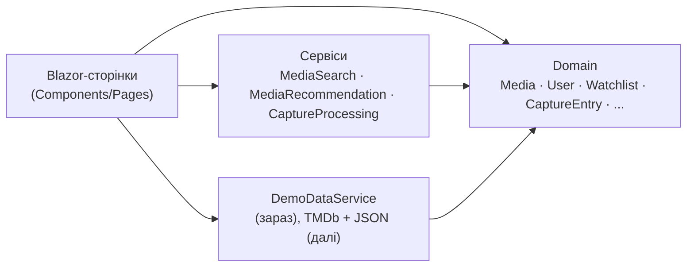

<div align="center">


# Myosotis

**collect · watch · remember**

Персональний трекер фільмів і серіалів, який починається не з назви,
а з моменту, коли щось тебе зачепило.


<!-- TODO: скріншот Overview у docs/images/overview.png -->


</div>

---

## Ідея

Фільм часто трапляється випадково: уривок у TikTok, порада друга, сцена, яку пам'ятаєш,
а назви не знаєш. Каталоги (IMDb, Letterboxd) починають працювати, коли назва вже відома.

**Myosotis** починає раніше. Ти зберігаєш **Capture**: цитату, сцену або думку у вільній формі,
навіть без назви. Пізніше пов'язуєш її з конкретним фільмом чи серіалом і додаєш до списку.
Назва застосунку (незабудка, *myosotis*) про те саме: не забути.

## Можливості

| | |
|---|---|
| **Captures** | Нотатки чотирьох типів (Thought, Quote, Scene, Note) з таймкодом, власною приміткою і тегами. Стани: `Unresolved` → `Resolved` → `Archived` |
| **Watchlists** | Власні підбірки, приватні та публічні, з особистою нотаткою до кожного тайтла |
| **Tracking** | Статуси `Planned`, `Watching`, `Watched`, `Paused`, `Dropped`, `Rewatching` |
| **Continue watching** | Пауза серіалу: сезон, серія, таймкод, причина, відсоток серії |
| **Roulette** | Випадковий вибір із того, що ще не переглянуто, за часом, що є, і жанром |
| **Recommendations** | «Схоже на те, що ти дивилась» за спільними жанрами |
| **Vibe Rating** | Оцінка за шістьма критеріями: Characters, Plot, Visuals, Pacing, Vibe, Soundtrack |
| **Статистика** | Місяць: кількість переглянутого, час, жанри, режисер, якого дивилась найчастіше |
| **Пошук** | За назвою, жанром і актором |

## Скріншоти

<!-- TODO: додай 2–3 скріншоти у docs/images/ -->
| Overview | Captures |
|---|---|
|  |  |

## Технології

| Шар | Що використано |
|---|---|
| Мова й платформа | C#, .NET 10 |
| Інтерфейс | Blazor (Server, Interactive) |
| Стилі | Tailwind CSS (CDN), MudBlazor (діалоги, сповіщення), Material Symbols |
| Дані зараз | Демонстраційні дані в пам'яті (`DemoDataService`) |
| Дані далі | TMDb API (метадані й постери), збереження у JSON |

## Запуск

Потрібен [.NET 10 SDK](https://dotnet.microsoft.com/download).

```bash
git clone https://github.com/borjomiversus/Myosotis.git
cd Myosotis/MyosotisWeb    # TODO: перевір назву папки проєкту
dotnet run
```

Відкрий адресу, яку покаже термінал (наприклад, `https://localhost:5001`).

> Дані демонстраційні та живуть у пам'яті: після перезапуску застосунок повертається до початкового стану.

## Структура

```text
Myosotis/
├── MyosotisWeb/
│   ├── Domain/                 # предметна область (не залежить від інтерфейсу)
│   │   ├── Media/              # Media, Movie, Series, Season, Episode, Song
│   │   ├── People/             # Person, Actor, Director
│   │   ├── Users/              # User, UserMediaState, WatchCheckpoint, WatchHistoryEntry
│   │   ├── Collections/        # Watchlist, WatchlistEntry
│   │   ├── Interactions/       # CaptureEntry, Review, VibeRating, RouletteCriteria
│   │   └── Services/           # MediaSearch, MediaRecommendation, CaptureProcessing
│   ├── Components/
│   │   ├── Layout/             # MainLayout
│   │   └── Pages/              # Overview, Watchlists, Captures, History, Search
│   ├── ServicesWeb/            # DemoDataService, UiHelpers
│   └── wwwroot/
└── docs/                       # діаграми, скріншоти, звіти
```

<!-- TODO: звір дерево з реальними папками -->

## Архітектура

Логіка живе в доменному шарі й нічого не знає про інтерфейс: ті самі класи працювали
і в консольній версії, і в Blazor.



Діаграма класів: [`docs/uml.md`](docs/uml.md) <!-- TODO: поклади сюди Mermaid-код діаграми -->

## Модель домену

| Клас | Призначення |
|---|---|
| `Media` (abstract) → `Movie`, `Series` | Тайтл; `CalculateTimeDebt()` у кожного свій: тривалість фільму чи залишок серій |
| `Person` → `Actor`, `Director` | Люди, пов'язані з тайтлом |
| `User` | Власник підбірок, нотаток, історії, статусів і чекпоінтів |
| `CaptureEntry` | Необроблена згадка, яка пізніше стає зв'язаною з тайтлом |
| `Watchlist`, `WatchlistEntry` | Підбірка й запис у ній з особистою нотаткою |
| `WatchCheckpoint` | «Де я зупинилась і чому» |
| `VibeRating` | Шестикритеріальна оцінка (значення 0–10, перевіряються в конструкторі) |

<details>
<summary>Відповідність вимогам лабораторних</summary>

<!-- TODO: заповни точними цифрами після підрахунку; цей блок не обов'язковий для README -->

| Вимога лаби 1 | Де в коді |
|---|---|
| Ієрархії успадкування | `Media → Movie / Series`, `Person → Actor / Director` |
| Динамічний поліморфізм | `Media.CalculateTimeDebt()` (abstract / override) |
| Поліморфізм через інтерфейс | `IComparable<Media>` у `Media` |
| Статичний поліморфізм (generics) | TODO: потрібен власний generic-тип або метод |
| Інкапсуляція | `private set`, валідація у конструкторах |

Лаба 2: графічний інтерфейс (Blazor, 5 сторінок). Лаба 3: зовнішні бібліотеки (TODO: вказати, які саме).

</details>

## Дорожня карта

- [x] Предметна модель і сервіси
- [x] Blazor-інтерфейс: Overview, Watchlists, Captures, History, Search
- [x] Roulette, рекомендації, статистика місяця
- [ ] Сторінка фільму / серіалу
- [ ] Підключення TMDb (метадані, постери)
- [ ] Збереження даних у JSON
- [ ] Публікація в Azure
- [ ] Користувацький профіль

## Як це створювалося

Чесно про інструменти:

- **Ідея, назва, палітра, вибір технологій, структура даних і рішення, що залишити, а що прибрати** — авторські.
- **Бренд-ідентика:** палітра зібрана на coolors.co, логотип і дошка зроблені в Canva. <!-- TODO: звір -->
- **Дизайн інтерфейсу:** чернетки згенеровано в Google Stitch, далі розмітка адаптована вручну під власні дані та палітру.
- **Код і рефакторинг:** частину написано за допомогою LLM (ChatGPT, Claude), частину самостійно. Кожен фрагмент перевірено, зібрано й запущено.

<!-- TODO: переглянь цей розділ і виправ усе, що не відповідає дійсності -->

## Джерела

**Документація:** [Blazor](https://learn.microsoft.com/aspnet/core/blazor/hosting-models) ·
[MudBlazor](https://mudblazor.com/docs/overview) ·
[TMDb API](https://developer.themoviedb.org/docs/getting-started) ·
[Виклик web API з .NET](https://learn.microsoft.com/dotnet/csharp/tutorials/console-webapiclient)

**Приклади коду:** [Movie-Tracker-App](https://github.com/ertugrulgacal/Movie-Tracker-App) ·
[movieTracker](https://github.com/LeilaniL/movieTracker) ·
[Movie-Website](https://github.com/krishnashah122/Movie-Website)

**Натхнення в дизайні:** [Dribbble](https://dribbble.com/tags/glassmorphism) ·
[Spotify Wrapped Dashboard](https://dribbble.com/shots/14686871-2020-Spotify-Wrapped-Dashboard-Concept) ·
[Serializd](https://serializd.com/discover)

**Навчальні відео:** [Blazor](https://www.youtube.com/watch?v=dY_AWdCzsCY&list=PLzewa6pjbr3IQEUfNiK2SROQC1NuKl6PV&index=1) ·
[Tailwind](https://www.youtube.com/watch?v=xS4ISh6ZehU) ·
[TMDb](https://www.youtube.com/watch?v=FlFyrOEz2S4)

<!-- TODO: коли підключиш TMDb, додай обов'язкову атрибуцію з їхньої сторінки умов використання -->

## Автор

<!-- TODO: ім'я, група, посилання на Telegram або email за бажанням -->

Навчальний проєкт з дисципліни «Парадигма та інструментальні засоби розробки ООП», КНУ імені Тараса Шевченка.

## Ліцензія

<!-- TODO: обери ліцензію (наприклад, MIT) або прибери розділ -->
