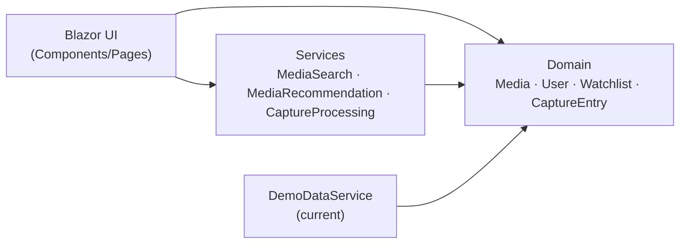

---

## Ідея

Ти можеш побачити сцену, цитату або рекомендацію в соцмережі, але ще не знати назву фільму.

**Myosotis** дає змогу зберегти цей момент як **Capture**, а пізніше пов'язати його
з конкретним фільмом або серіалом.

---

## Можливості

| | Feature | Description |
|---|---|---|
| ✦ | **Captures** | Нотатки типів `Thought`, `Quote`, `Scene` і `Note` з таймкодом, приміткою та тегами |
| 📚 | **Watchlists** | Власні приватні та публічні підбірки з особистою нотаткою до кожного тайтла |
| ▶️ | **Tracking** | Статуси `Planned`, `Watching`, `Watched`, `Paused`, `Dropped`, `Rewatching` |
| ⏸️ | **Checkpoints** | Збереження сезону, серії, таймкоду, причини паузи та відсотка перегляду |
| 🎲 | **Roulette** | Випадковий вибір того, що ще не переглянуто, за доступним часом і жанром |
| ✧ | **Recommendations** | Підбір схожих тайтлів за спільними жанрами |
| ★ | **Vibe Rating** | Оцінювання за критеріями Characters, Plot, Visuals, Pacing, Vibe і Soundtrack |
| ◷ | **Statistics** | Статистика переглядів, часу, жанрів і найчастіше переглянутого режисера |
| ⌕ | **Search** | Пошук за назвою, жанром і актором |

---

## Screenshots


| Overview | Captures |
|---|---|
| `docs/images/overview.png` | `docs/images/captures.png` |

---

## Tech Stack

| Technology | Usage |
|---|---|
| **C# / .NET 10** | Core platform |
| **Blazor Server** | Interactive user interface |
| **Tailwind CSS** | Styling |
| **MudBlazor** | Dialogs and notifications |
| **Material Symbols** | Icons |
| **DemoDataService** | In-memory demonstration data |

---

## Architecture

Myosotis keeps the domain logic separate from the user interface:



The domain layer does not depend on the interface. The same domain classes were designed
to work with both the console version and the Blazor application.

---

## Domain Model

| Class | Purpose |
|---|---|
| `Media` | Abstract base entity for media content |
| `Movie` / `Series` | Media types with their own `CalculateTimeDebt()` implementation |
| `Season` / `Episode` / `Song` | Media-related entities |
| `Person` / `Actor` / `Director` | People associated with a title |
| `User` | Owner of watchlists, captures, history, statuses and checkpoints |
| `Watchlist` / `WatchlistEntry` | Collection of titles with personal notes |
| `CaptureEntry` | Unresolved quote, scene or thought that can later be linked to a title |
| `WatchCheckpoint` | Saved series watching position and pause reason |
| `VibeRating` | Six-criteria rating with values from `0` to `10` |


---

## Project Structure

```text
Myosotis/
├── MyosotisWeb/
│   ├── Domain/
│   │   ├── Media/
│   │   ├── People/
│   │   ├── Users/
│   │   ├── Collections/
│   │   ├── Interactions/
│   │   └── Services/
│   ├── Components/
│   │   ├── Layout/
│   │   └── Pages/
│   ├── ServicesWeb/
│   └── wwwroot/
└── docs/
```

---

## Run Locally

Requires <a href="https://dotnet.microsoft.com/download">.NET 10 SDK</a>.

```bash
git clone https://github.com/borjomiversus/Myosotis.git
cd Myosotis/MyosotisWeb    # TODO: verify the project folder name
dotnet run
```

Open the address shown in the terminal, for example:

```text
https://localhost:5001
```

---

## Roadmap

- [x] Domain model and services
- [x] Blazor interface: Overview, Watchlists, Captures, History and Search
- [x] Roulette, recommendations and monthly statistics
- [x] Movie and series details page
- [x] TMDb integration for metadata and posters
- [ ] Save data to JSON
- [ ] Publish to Azure
- [ ] User profile

---

## Sources

### Documentation

- <a href="https://learn.microsoft.com/aspnet/core/blazor/hosting-models">Blazor</a>
- <a href="https://mudblazor.com/docs/overview">MudBlazor</a>
- <a href="https://developer.themoviedb.org/docs/getting-started">TMDb API</a>
- <a href="https://learn.microsoft.com/dotnet/csharp/tutorials/console-webapiclient">.NET Web API client</a>

### Code Examples

- <a href="https://github.com/ertugrulgacal/Movie-Tracker-App">Movie-Tracker-App</a>
- <a href="https://github.com/LeilaniL/movieTracker">movieTracker</a>
- <a href="https://github.com/krishnashah122/Movie-Website">Movie-Website</a>

### Design Inspiration

- <a href="https://dribbble.com/tags/glassmorphism">Glassmorphism</a>
- <a href="https://dribbble.com/shots/14686871-2020-Spotify-Wrapped-Dashboard-Concept">Spotify Wrapped Dashboard</a>
- <a href="https://serializd.com/discover">Serializd</a>

### Learning Resources

- <a href="https://www.youtube.com/watch?v=dY_AWdCzsCY&amp;list=PLzewa6pjbr3IQEUfNiK2SROQC1NuKl6PV&amp;index=1">Blazor tutorial</a>
- <a href="https://www.youtube.com/watch?v=xS4ISh6ZehU">Tailwind CSS tutorial</a>
- <a href="https://www.youtube.com/watch?v=FlFyrOEz2S4">TMDb tutorial</a>

---

## License

License not defined yet.
