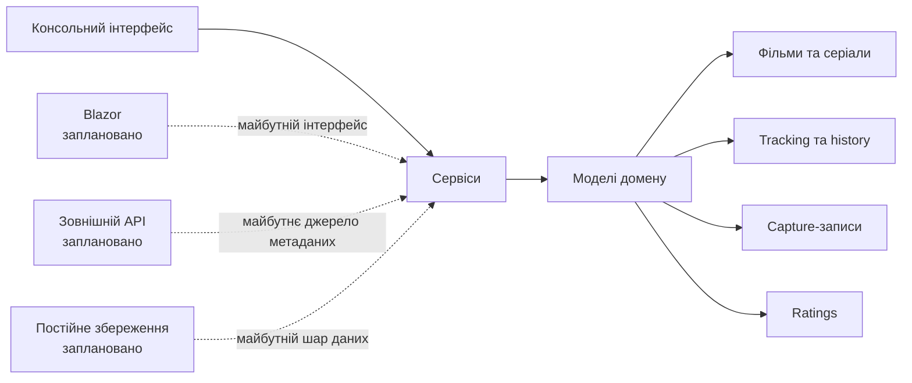

<div align="center">


# Myosotis

**collect · watch · remember**

Персональний застосунок для пошуку, організації та відстеження фільмів і серіалів.

[](https://learn.microsoft.com/dotnet/csharp/)
[](https://dotnet.microsoft.com/)
[](#стан-реалізації)

</div>

---

## Що таке Myosotis?

**Myosotis** — персональна система для роботи з фільмами та серіалами: пошуку, створення власних списків, ведення історії перегляду, оцінювання та відстеження прогресу.

Головна особливість проєкту — **Capture**. Користувач може спочатку зберегти нечітку згадку, цитату, сцену або рекомендацію з TikTok, Instagram чи від друга, а вже пізніше визначити відповідний фільм або серіал і структурувати запис.

> Ідея Myosotis — не лише зберігати назви, а й не втрачати особистий контекст, у якому контент було знайдено.

## Основні можливості

| Можливість | Опис |
|---|---|
| 🎬 **Каталог** | Робота з фільмами та серіалами, їхньою основною інформацією, жанрами, тегами й акторами. |
| 🔎 **Пошук** | Пошук за назвою, фільтрація за жанром і розширений пошук за жанром та роком. |
| 📚 **Watchlists** | Створення власних списків і додавання до них медіа з особистими нотатками. |
| 📝 **Capture** | Збереження необробленої згадки про контент із можливістю структурувати її пізніше. |
| ▶️ **Tracking** | Персональні статуси перегляду: `Planned`, `Watching`, `Watched`, `Paused`, `Dropped`, `Rewatching`. |
| ⏸️ **Checkpoints** | Збереження позиції та причини зупинки під час перегляду епізоду. |
| ⭐ **Vibe Rating** | Оцінювання за критеріями `Characters`, `Plot`, `Visuals`, `Pacing`, `Vibe` та `Soundtrack`. |
| 🎲 **Roulette** | Вибір контенту з урахуванням доступного часу або жанру. |
| ✨ **Recommendations** | Базовий механізм пошуку схожого контенту. |

### Стани Capture

Capture-запис може перебувати в одному з трьох станів:

- `Unresolved` — медіа ще не визначено;
- `Resolved` — запис пов’язано з конкретним фільмом або серіалом;
- `Archived` — запис заархівовано.

## Перегляд серіалів

Серіали підтримують сезони та епізоди. Для епізоду можна зберегти checkpoint перегляду — позицію та причину, через яку перегляд було зупинено.

## Скріншоти

Інтерфейс проєкту ще перебуває на етапі планування, тому готові скріншоти графічної версії відсутні.

Замініть ці блоки на зображення, коли вони з’являться:

```text
docs/images/overview.png

docs/images/captures.png

docs/images/watchlists.png
```

## Технології

| Категорія | Поточний стан |
|---|---|
| Мова | **C#** |
| Платформа | **.NET 10** |
| Поточний інтерфейс | Консольна версія |
| Графічний інтерфейс | **Blazor** — заплановано для першої графічної версії |
| Зовнішні дані | Підключення API метаданих фільмів і серіалів — заплановано |
| Постійне збереження | Заплановано |

Blazor має виконувати роль інтерфейсного шару, тоді як основна логіка проєкту залишатиметься в окремих класах і сервісах.

## Архітектура

Поточна версія проєкту є консольною. Логіка роботи з медіа, пошуком, Capture, рекомендаціями та Roulette зосереджена в моделях і сервісах.



## Основні доменні сутності

| Сутність | Призначення |
|---|---|
| **Media** | Базове представлення медіаконтенту. |
| **Movie** | Модель фільму. |
| **Series** | Модель серіалу із сезонами та епізодами. |
| **Season** | Сезон серіалу. |
| **Episode** | Окремий епізод серіалу. |
| **User** | Користувач і його персональний контекст перегляду. |
| **Watchlist** | Власний список медіа користувача. |
| **Capture** | Необроблена згадка або рекомендація, яку можна пов’язати з медіа пізніше. |
| **WatchCheckpoint** | Збережена позиція та причина зупинки перегляду епізоду. |
| **Vibe Rating** | Деталізована оцінка медіа за шістьма критеріями. |
| **History** | Історія перегляду. |
| **Tracking** | Поточний персональний статус перегляду. |

## ООП та навчальний контекст

Проєкт створено як студентський C#/.NET-проєкт для практики об’єктно-орієнтованого програмування та проєктування предметної області.

У Myosotis використовуються:

- окремі моделі для фільмів, серіалів, сезонів, епізодів, користувача та персональних записів;
- інкапсуляція даних і поведінки в класах предметної області;
- сервіси для пошуку, роботи з Capture, рекомендацій і Roulette;
- розділення доменної логіки та інтерфейсу, що має спростити подальше підключення Blazor.

## Стан реалізації

### Реалізовано

- [x] Консольна версія на C#/.NET 10
- [x] Моделі медіа та користувача
- [x] Моделі списків і Capture-записів
- [x] Моделі сезонів та епізодів
- [x] Ratings, history та tracking
- [x] Сервіс пошуку
- [x] Сервіс роботи з Capture
- [x] Базові рекомендації
- [x] Roulette

### Заплановано

- [ ] Графічний інтерфейс на Blazor
- [ ] Підключення зовнішнього API для метаданих фільмів і серіалів
- [ ] Постійне збереження даних
- [ ] Авторизація та користувацький профіль
- [ ] Розширення рекомендаційної та соціальної функціональності

## Запуск локально

Поточна реалізація є консольною. Команди запуску та точний шлях до проєкту не наведені в поточному описі репозиторію, тому їх потрібно уточнити відповідно до фактичної структури solution.

```text
<!-- update: додайте точні команди після перевірки структури .sln/.csproj -->
```

## Brand identity

Назва, візуальний напрям і палітра проєкту розроблялися для майбутнього графічного інтерфейсу.

**Палітра:** [Coolors](https://coolors.co/1a2235-332d57-5c80bc-84dcc6-e2e8f0-d4915a)

## Інструменти та джерела

### Документація

- [C# — Microsoft Learn](https://learn.microsoft.com/en-us/dotnet/csharp/)
- [Blazor hosting models](https://learn.microsoft.com/en-us/aspnet/core/blazor/hosting-models?view=aspnetcore-10.0#blazor-webassembly)
- [Calling a web API from a .NET client](https://learn.microsoft.com/en-us/dotnet/csharp/tutorials/console-webapiclient)
- [ASP.NET Web API: calling a web API from a .NET client](https://learn.microsoft.com/fr-fr/aspnet/web-api/overview/advanced/calling-a-web-api-from-a-net-client)
- [TMDb API documentation](https://developer.themoviedb.org/docs/getting-started)
- [TMDb movie details](https://developer.themoviedb.org/reference/movie-details)
- [MudBlazor documentation](https://mudblazor.com/docs/overview)

### Приклади коду

- [Movie Tracker App](https://github.com/ertugrulgacal/Movie-Tracker-App)
- [movieTracker](https://github.com/LeilaniL/movieTracker)
- [Awesome Blazor](https://github.com/AdrienTorris/awesome-blazor)
- [Movie Website](https://github.com/krishnashah122/Movie-Website)
- [JSON to C#](https://json2csharp.com/)

### Дизайн і візуальні референси

- [Glassmorphism — Dribbble](https://dribbble.com/tags/glassmorphism)
- [Raycast — Dribbble](https://dribbble.com/search/raycast)
- [Spotify Wrapped Dashboard Concept](https://dribbble.com/shots/14686871-2020-Spotify-Wrapped-Dashboard-Concept)
- [Abstract Star Logo Concept](https://dribbble.com/shots/26983428-Abstract-Star-Logo-Concept-Modern-Gradient-Logo-Concept-for-App)
- [Movie site concepts — Dribbble](https://dribbble.com/search/movie-site)
- [Serializd Discover](https://serializd.com/discover)
- [Movie Suggest](https://moviesuggest.netlify.app/)
- [Origin UI](https://www.originkit.dev/)
- [Smooth UI](https://smoothui.dev/docs/components)
- [Design.dev tools](https://design.dev/tools/)

### Навчальні матеріали

- [Blazor tutorial](https://www.youtube.com/watch?v=dY_AWdCzsCY&list=PLzewa6pjbr3IQEUfNiK2SROQC1NuKl6PV&index=1)
- [Tailwind CSS tutorial](https://www.youtube.com/watch?v=xS4ISh6ZehU)
- [TMDb tutorial](https://www.youtube.com/watch?v=FlFyrOEz2S4)
- [Відеокурс з C#/.NET](https://www.youtube.com/watch?v=03YGv7Myb3o&list=PLbDsRCGLbN1_-ZWS6G5ionKox0Ahrdv_H)

## Використання LLM

Під час розробки використовувалися LLM-інструменти як допоміжний засіб для написання й рефакторингу коду, пошуку ідей для дизайну та підготовки документації.

Архітектурні рішення, набір функцій і фінальна реалізація були переглянуті та визначені автором проєкту.

## Авторський та академічний контекст

Myosotis — персональний навчальний проєкт, створений для практики C#, .NET та об’єктно-орієнто��аного проєктування на прикладі предметної області фільмів і серіалів.

## Ліцензія

Ліцензію для проєкту ще не визначено.
