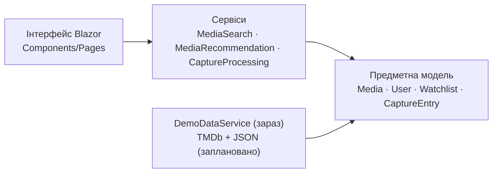

 <div align="center">


# Myosotis

**collect · watch · remember**

> Персональний трекер фільмів і серіалів.


</div>

---

## Ідея

Ти можеш побачити сцену, почути цитату або отримати рекомендацію в соціальних мережах, але так і не дізнатися назву фільму чи серіалу.

**Myosotis** дає змогу спочатку зберегти цей момент як **Capture**, а пізніше пов'язати його з конкретним фільмом або серіалом і додати до свого процесу відстеження перегляду.

## Можливості

| | Функція | Опис |
|---|---|---|
|  Captures | Нотатки типів `Thought`, `Quote`, `Scene`, `Note` зі статусами `Unresolved → Resolved → Archived` |
|  Watchlists | Приватні та публічні добірки з особистими нотатками до кожного тайтлу |
|  Tracking | Статуси перегляду: `Planned`, `Watching`, `Watched`, `Paused`, `Dropped`, `Rewatching` |
|  WatchCheckpoint | Збереження контексту перегляду: сезон і серія або таймкод, а також причина паузи |
|  Roulette | Випадковий вибір серед ще не переглянутих тайтлів з урахуванням доступного часу та жанру |
|  Recommendations | Рекомендації схожих тайтлів на основі спільних жанрів |
|  Vibe Rating | Оцінювання за шістьма критеріями: Characters, Plot, Visuals, Pacing, Vibe, Soundtrack |
|  Статистика | Щомісячна статистика переглядів: кількість, час, жанри та режисер, чиї роботи переглядалися найчастіше |
|  Пошук | Пошук за назвою, жанром та актором |

## Технології

| Технологія | Призначення |
|---|---|
| C# / .NET 10 | Основна мова програмування та середовище виконання |
| Blazor Server | Користувацький інтерфейс |
| Tailwind CSS (CDN) | Стилізація інтерфейсу |
| MudBlazor | Діалогові вікна та сповіщення |
| Material Symbols | Іконки |
| TBDB API | База медіа |

## Поточний стан

- Реалізовано предметну модель і основні сервіси.
- Створено сторінки Blazor: Overview, Watchlists, Captures, History, Search.
- Наразі використовуються лише демонстраційні дані, що зберігаються в пам'яті.
- Сторінка детальної інформації про фільм або серіал, інтеграція TMDb, збереження даних у JSON та розгортання застосунку заплановані на наступні етапи.

## Архітектура



Основний потік взаємодії: `Blazor UI → Services → Domain`.

## Модель предметної області (основні класи)

| Клас | Призначення |
|---|---|
| `Media` | Абстрактна базова сутність медіаконтенту |
| `Movie` / `Series` | Типи медіаконтенту |
| `Person` / `Actor` / `Director` | Люди, пов'язані з тайтлами |
| `User` | Власник списків, нотаток, історії перегляду, статусів і чекпоінтів |
| `Watchlist` / `WatchlistEntry` | Користувацькі добірки та записи в них |
| `CaptureEntry` | Необроблена нотатка, яку згодом можна пов'язати з конкретним тайтлом |
| `WatchCheckpoint` | Збережена позиція перегляду та контекст паузи |
| `VibeRating` | Оцінювання за шістьма критеріями з перевіркою значень у діапазоні 0–10 |

## Скріншоти

Файли скріншотів, згадані в попередніх версіях, наразі **відсутні в цьому репозиторії**:

- `docs/images/overview.png`
- `docs/images/captures.png`

## Локальний запуск

Для запуску потрібен [.NET 10 SDK](https://dotnet.microsoft.com/download).

```bash
git clone https://github.com/borjomiversus/Myosotis.git
cd Myosotis/MyosotisWeb    # TODO: перевірити назву папки проєкту
dotnet run
```

Після запуску відкрий адресу, яку покаже термінал (наприклад, `https://localhost:5001`).

## Структура проєкту

```text
Myosotis/
├── MyosotisWeb/      # Застосунок Blazor (інтерфейс і вебсервіси)
├── code/             # Предметна модель і основна логіка
├── Myosotis.Tests/   # Тести
└── README.md
```

## Дорожня карта

- [x] Предметна модель і сервіси
- [x] Інтерфейс Blazor: Overview, Watchlists, Captures, History, Search
- [x] Roulette, рекомендації, щомісячна статистика
- [x] Сторінка фільму / серіалу
- [x] Інтеграція TMDb (метадані та постери)
- [ ] Збереження даних у JSON
- [ ] Розгортання в Azure
- [ ] Користувацький профіль

## Процес розробки

- Ідея продукту, назва, палітра, вибір технологій і рішення щодо структури даних визначені.
- Спочатку було досліджено та створено прототип дизайну, який згодом адаптовано вручну.
- Інструменти штучного інтелекту (Claude, Gemini, Google Studio) використовувалися як допоміжні засоби для роботи з кодом, рефакторингу, дизайном і документацією з подальшою ручною перевіркою.

## Джерела

### Документація

- [Blazor](https://learn.microsoft.com/aspnet/core/blazor/hosting-models)
- [MudBlazor](https://mudblazor.com/docs/overview)
- [TMDb API](https://developer.themoviedb.org/docs/getting-started)
- [Клієнт для роботи з Web API у .NET](https://learn.microsoft.com/dotnet/csharp/tutorials/console-webapiclient)

### Приклади коду

- [Movie-Tracker-App](https://github.com/ertugrulgacal/Movie-Tracker-App)
- [movieTracker](https://github.com/LeilaniL/movieTracker)
- [Movie-Website](https://github.com/krishnashah122/Movie-Website)

### Натхнення для дизайну

- [Glassmorphism (Dribbble)](https://dribbble.com/tags/glassmorphism)
- [Spotify Wrapped Dashboard Concept](https://dribbble.com/shots/14686871-2020-Spotify-Wrapped-Dashboard-Concept)
- [Serializd](https://serializd.com/discover)

### Навчальні матеріали

- [Посібник із Blazor](https://www.youtube.com/watch?v=dY_AWdCzsCY&list=PLzewa6pjbr3IQEUfNiK2SROQC1NuKl6PV&index=1)
- [Посібник із Tailwind CSS](https://www.youtube.com/watch?v=xS4ISh6ZehU)
- [Посібник із TMDb](https://www.youtube.com/watch?v=FlFyrOEz2S4)

## Ліцензія

Ліцензію ще не визначено.
