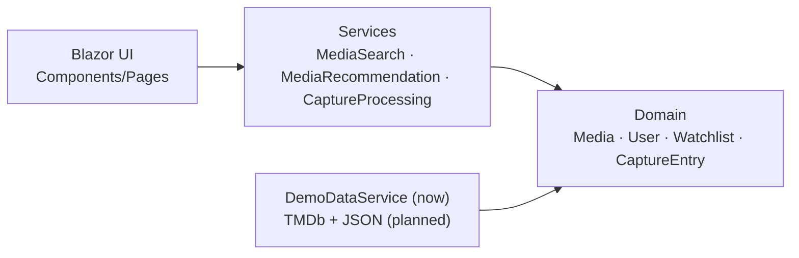

<div align="center">
  

  # Myosotis

  **collect · watch · remember**

  > Personal movie & series tracker that starts not with a title, but with the moment something catches your attention.

  
  
  
  
  
  
</div>

## Capture-first idea

You might see a scene, quote, or recommendation in social media and still not know the title.

**Myosotis** lets you save that moment as a **Capture** first, then later resolve it into a specific movie/series and move it into your watch flow.

## Features

| | Feature | Description |
|---|---|---|
| 🎬 | Captures | Notes of type `Thought`, `Quote`, `Scene`, `Note` with states `Unresolved → Resolved → Archived` |
| 📚 | Watchlists | Private/public collections with personal notes for each title |
| ▶️ | Tracking | `Planned`, `Watching`, `Watched`, `Paused`, `Dropped`, `Rewatching` |
| ⏸️ | WatchCheckpoint | Continue-watching context: season/episode or timecode + pause reason |
| 🎲 | Roulette | Random pick from unwatched titles filtered by available time and genre |
| ✦ | Recommendations | Similar titles based on shared genres |
| ★ | Vibe Rating | Six criteria: Characters, Plot, Visuals, Pacing, Vibe, Soundtrack |
| 📊 | Statistics | Monthly watch stats: count, time, genres, top director |
| 🔎 | Search | By title, genre, and actor |

## Tech stack

| Technology | Usage |
|---|---|
| C# / .NET 10 | Core language & runtime |
| Blazor Server (Interactive) | UI |
| Tailwind CSS (CDN) | Styling |
| MudBlazor | Dialogs and notifications |
| Material Symbols | Icons |
| `DemoDataService` | Current in-memory demo data source |

## Current status

- Domain model and core services are implemented.
- Blazor pages: Overview, Watchlists, Captures, History, Search.
- Data is currently demo-only (in memory).
- Movie/series detail page, TMDb integration, JSON persistence, and deployment are in roadmap.

## Architecture



Flow: `Blazor UI → Services → Domain`.

## Domain model (core classes)

| Class | Purpose |
|---|---|
| `Media` | Abstract base media entity |
| `Movie` / `Series` | Media types with their own `CalculateTimeDebt()` behavior |
| `Person` / `Actor` / `Director` | People linked to titles |
| `User` | Owns watchlists, captures, history, statuses, checkpoints |
| `Watchlist` / `WatchlistEntry` | User collections and entries |
| `CaptureEntry` | Unresolved note that can later be linked to a title |
| `WatchCheckpoint` | Saved watching position and pause context |
| `VibeRating` | Six-dimensional score with validation (0–10) |

<details>
<summary>OOP focus (university requirements)</summary>

- **Inheritance:** `Media → Movie / Series`, `Person → Actor / Director`
- **Abstraction:** abstract base models and abstract `CalculateTimeDebt()`
- **Encapsulation:** `private set` and constructor validation
- **Dynamic polymorphism:** `override` implementations in media types
- **Interface-based polymorphism:** `IComparable<Media>` in `Media`
- **Static polymorphism (generics):** TODO in current lab requirements

</details>

## Screenshots

Screenshot files mentioned in previous versions are currently **not present** in this repository:

- `docs/images/overview.png`
- `docs/images/captures.png`

## Run locally

Requires [.NET 10 SDK](https://dotnet.microsoft.com/download).

```bash
git clone https://github.com/borjomiversus/Myosotis.git
cd Myosotis/MyosotisWeb    # TODO: verify the project folder name
dotnet run
```

Then open the URL shown in the terminal (for example, `https://localhost:5001`).

## Project structure

```text
Myosotis/
├── MyosotisWeb/      # Blazor app (UI + web services)
├── code/             # Domain model and core logic
├── Myosotis.Tests/   # Tests
└── README.md
```

## Roadmap

- [x] Предметна модель і сервіси
- [x] Blazor-інтерфейс: Overview, Watchlists, Captures, History, Search
- [x] Roulette, рекомендації, статистика місяця
- [ ] Сторінка фільму / серіалу
- [ ] Підключення TMDb (метадані, постери)
- [ ] Збереження даних у JSON
- [ ] Публікація в Azure
- [ ] Користувацький профіль

## Development process

- Product idea, naming, palette, tech choices, and data structure decisions are author-driven.
- Design was explored/prototyped first, then adapted manually.
- AI tools (ChatGPT, Claude) were used as assistants for code, refactoring, design, and documentation, with manual verification.

## Sources

### Documentation

- [Blazor](https://learn.microsoft.com/aspnet/core/blazor/hosting-models)
- [MudBlazor](https://mudblazor.com/docs/overview)
- [TMDb API](https://developer.themoviedb.org/docs/getting-started)
- [.NET Web API client](https://learn.microsoft.com/dotnet/csharp/tutorials/console-webapiclient)

### Code examples

- [Movie-Tracker-App](https://github.com/ertugrulgacal/Movie-Tracker-App)
- [movieTracker](https://github.com/LeilaniL/movieTracker)
- [Movie-Website](https://github.com/krishnashah122/Movie-Website)

### Design inspiration

- [Glassmorphism (Dribbble)](https://dribbble.com/tags/glassmorphism)
- [Spotify Wrapped Dashboard Concept](https://dribbble.com/shots/14686871-2020-Spotify-Wrapped-Dashboard-Concept)
- [Serializd](https://serializd.com/discover)

### Learning resources

- [Blazor tutorial](https://www.youtube.com/watch?v=dY_AWdCzsCY&list=PLzewa6pjbr3IQEUfNiK2SROQC1NuKl6PV&index=1)
- [Tailwind CSS tutorial](https://www.youtube.com/watch?v=xS4ISh6ZehU)
- [TMDb tutorial](https://www.youtube.com/watch?v=FlFyrOEz2S4)

## Academic context

Навчальний проєкт з дисципліни «Парадигма та інструментальні засоби розробки ООП», КНУ імені Тараса Шевченка.

## License

License not defined yet.
